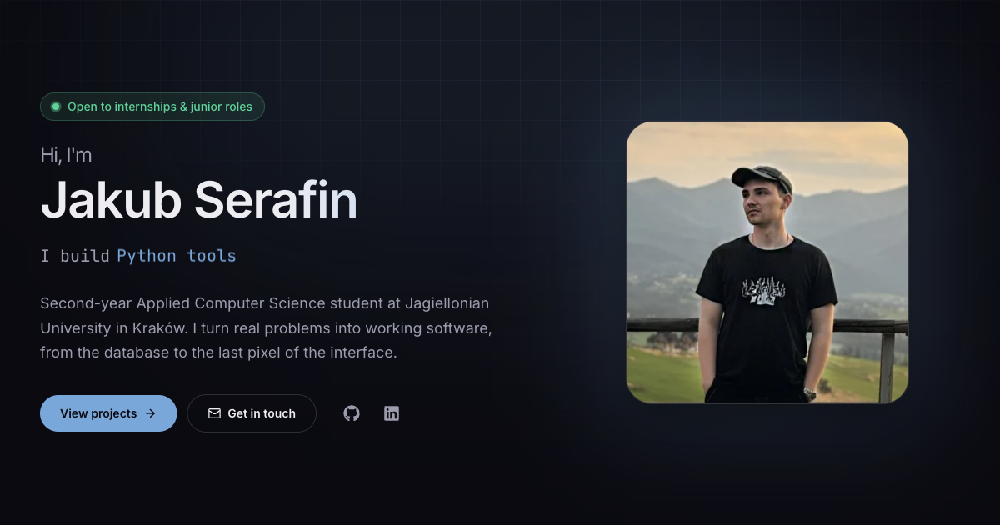

# Jakub Serafin — Portfolio

Personal portfolio of Jakub Serafin, Applied Computer Science student at Jagiellonian University.



## Stack

- React 19 + TypeScript, built with Vite
- Tailwind CSS 4
- [Animate UI](https://animate-ui.com) + Motion for animations
- English / Polish language switch
- Deployed to GitHub Pages via GitHub Actions

## Run locally

```bash
npm install
npm run dev
```

Production build: `npm run build` (output in `dist/`).
